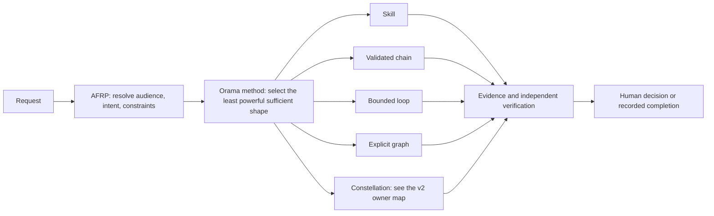

# Architecture Map — v1 Orama System

This map explains how the legacy orama-system v1 organizes work. It is
a routing guide: from a request to the owning contract, skill,
execution shape, evidence, and explicit completion state. It is a map
of the treasure trail—not a replacement runtime, a second graph schema, or an
authority grant. The system will always remain independent of v2 services
as its contracts are reviewed and migrated.

## Start Here

Choose the least powerful shape that makes ownership, effects, recovery, and
completion explicit. The shapes are alternatives, not stages: a skill is a
capability; a chain sequences known steps; a loop needs a measurable exit
condition; a graph is warranted only when topology or conditional state must be
made inspectable; and a constellation applies when several repositories or
owners compose one system. A *shape* is not an AFRP *mode* (Mode 1, 2, or 3
sets how much machinery the work uses). The constellation shape is described by
the [Oramasys architecture map](https://github.com/oramasys/oramasys/blob/main/ARCHITECTURE.md);
this map links to it for orientation and does not depend on it at runtime. Load the
[escalation card](bin/orama-system/cidf/references/skill-chain-loop-graph-reference-card.md)
only when that choice is non-obvious.

That CIDF reference card is the canonical compact route for
skill → chain → bounded loop → explicit graph escalation. CIDF remains the
content-insertion authority after the execution shape is selected.

## What Owns What

| Concern | Current owner | Boundary |
| --- | --- | --- |
| Audience, intent, and ambiguity | [AFRP](bin/orama-system/afrp/SKILL.md) | Route only after the task contract is clear. |
| Method, planning, and verification | [Orama system](bin/orama-system/SKILL.md) | Guides work; it does not confer authorization. |
| Content insertion | [CIDF](bin/orama-system/cidf/SKILL.md) | Preserve rank selection, automation gate, and readback. |
| Working coordination and operational memory | Perpetua-Tools | Treat records as scoped evidence, not universal authority. In v2, the Orchestrator Controller owns claims, handoffs, and leases; the Oramasys map has the owner row. |
| v2 structural graph primitives | `oramasys/perpetua-core` | Do not add a parallel v1 node or edge schema. |
| Endpoint, security, and hardware decisions | Telos, Phylax, and Agate | Keep their authority outside this method layer. |

The owner table names boundaries, not import relationships. In particular,
Orama v1 must not acquire a runtime dependency on successor services merely to
draw or document a graph.

## Treasures Carried by a Route

Every Markdown file should help a reader locate a decision, contract, test,
receipt, or source—not become a competing control plane. A route is complete
only when its links make these questions answerable:

| Map | What it routes to | What it must not claim |
| --- | --- | --- |
| Skill map | A bounded capability and its instructions | Authorization or completion by itself. |
| Chain/loop map | Step order, checkpoint, and exit condition | That an unverified retry repaired an external effect. |
| Graph map | State, ownership, handoffs, and typed relationships | A universal mutable common-ground record. |
| Evidence map | Sources, tests, artifacts, and limitations | That a citation is automatically a verified claim. |
| Constellation map | Which component owns each decision and interface | That all satellites are present or serving. |

## Five Related Graphs

Do not collapse distinct records into a single mutable “common ground.”

| Graph | Question | Grounding requirement |
| --- | --- | --- |
| Execution | What runs, and in what order? | States, transitions, checkpoints, and stop conditions. |
| Coordination | Who claims, hands off, or acknowledges work? | Author, actor, current state, and durable event identity. |
| Knowledge | What concepts or sources are related? | Source, time, confidence, and derived-state labeling. |
| Evidence | Why is a bounded claim supported? | Immutable references, tests, artifacts, or human decisions. |
| Audit | Who checked what and what remains unresolved? | Independent scope, authority, and limitations. |

The Oramasys architecture map mirrors this taxonomy and adds the v2 record
shapes; change both documents together.

Indexes, summaries, caches, and model consensus are derived views unless a
contract explicitly makes them authoritative. A passing check supports only its
stated conclusion; it is not merge, deployment, or operator approval.

## Operational Route

1. State the role, outcome, constraints, and authority boundary.
2. Use AFRP when the request is non-trivial, audience-dependent, or ambiguous.
3. Select a skill, chain, loop, graph, or constellation using the escalation card.
   These are alternatives, not stages.
4. Declare the state owner, effect owner, idempotency/recovery rule, and stop
   condition before an external or irreversible action.
5. Separate maker, evaluator, and approver where the effect matters.
6. Record evidence and limitations additively; preserve failed or uncertain
   attempts rather than converting them into success.

CIDF remains the required method for content insertion. The escalation card is
preprocessing for execution shape; it cannot bypass CIDF's rank order,
automation gate, target verification, or programmatic readback.

## Graph and Migration Contracts

The normative graph reconciliation work lives in the v2 specification corpus:

- [MiniGraph final reconciliation](docs/v2/57-minigraph-final-reconciliation.md)
- [Observer-pattern reconciliation](docs/v2/58-minigraph-observer-pattern-library-reconciliation.md)
- [State-mutation and observer finalization](docs/v2/59-minigraph-state-mutation-observer-finalization.md)
- [Structural graph and separately bound policy: D-LG-1](docs/v2/references/loop-graph-compatibility-2026-10-09/ADR-D-LG-1-POLICY-OWNERSHIP.md)
- [Runtime memory migration boundary](docs/v2/56-anamnesis-runtime-memory-migration.md)
- [Oramasys mastery standard](docs/v2/references/ORAMASYS-MASTERY-v3.md)

D-LG-1 originated in [the approved decision commit](https://github.com/diazMelgarejo/orama-system/commit/5d3fa7ab0030917858d7123a8466559f868dd91a).
Its current version preserves the original decision and the subsequent D-LG-5
amendment: reducer/join declarations belong to Core's structural identity;
application policy may restrict them.

Two useful but secondary matches provide the current qualification and
ownership split, plus the inspectable document-graph semantics for files,
concepts, decisions, implementation, evidence, handoffs, and security policy.
They do not supersede the contracts above:

- [PT loop/graph closure record](https://github.com/diazMelgarejo/Perpetua-Tools/blob/main/.agent/memory/working/LOOP_GRAPH_REVISION4_CLOSURE_2026-10-09.md):
  qualification, ownership split, evidence rules, and open limits.
- [Phase 0 LLM Wiki graph](https://github.com/diazMelgarejo/Perpetua-Tools/blob/main/docs/phase-0-specifications/wiki/README.md)
  and [typed edge semantics](https://github.com/diazMelgarejo/Perpetua-Tools/blob/main/docs/phase-0-specifications/wiki/edges.md):
  inspectable files, concepts, decisions, implementation, evidence, handoffs,
  and security-policy links.

## Readiness Boundary

This document improves navigation and design review. The local-workspace proof
now implements an offline, deterministic CSV + receipt slice; it does not
implement retrieval/model adapters, satellite wiring, serving, promotion, or
qualification. Those changes require a separately reviewed owner contract,
acceptance tests, evidence, and any required human decision.
