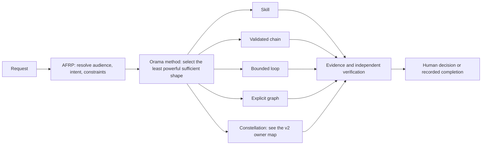

# Architecture Map — v1 Orama System

This map explains how the legacy orama-system v1 organizes work. It is
a routing guide: from a request to the owning contract, skill,
execution shape, evidence, and explicit completion state. It is a map
of the treasure trail—not a replacement runtime, a second graph schema, or an
authority grant. v1 takes no runtime dependency on v2 services while its
contracts are reviewed and migrated.

## Start Here

Choose the least powerful shape that makes ownership, effects, recovery, and
completion explicit. The shapes are alternatives, not stages: a skill is a
capability; a chain sequences known steps; a loop needs a measurable exit
condition; a graph is warranted only when topology or conditional state must be
made inspectable; and a constellation applies when several repositories or
owners compose one system. A *shape* is not an AFRP *mode* (Mode 1, 2, or 3
sets how much machinery the work uses). The constellation shape is described by
the [Oramasys architecture map](https://github.com/oramasys/oramasys/blob/main/ARCHITECTURE.md);
this map links to it for orientation and does not depend on it at runtime. Load the
[escalation card](bin/orama-system/cidf/references/skill-chain-loop-graph-reference-card.md)
only when that choice is non-obvious.

That CIDF reference card is the canonical compact route for
skill → chain → bounded loop → explicit graph escalation. CIDF remains the
content-insertion authority after the execution shape is selected.

## What Owns What

| Concern | Current owner | Boundary |
| --- | --- | --- |
| Audience, intent, and ambiguity | [AFRP](bin/orama-system/afrp/SKILL.md) | Route only after the task contract is clear. |
| Method, planning, and verification | [Orama system](bin/orama-system/SKILL.md) | Guides work; it does not confer authorization. |
| Content insertion | [CIDF](bin/orama-system/cidf/SKILL.md) | Preserve rank selection, automation gate, and readback. |
| v1 orchestration, coordination, telemetry and memory | Perpetua-Tools | Treat records as scoped evidence, not universal authority. The planned v2 controller owns job claims and job-claim leases; existing v2 execution run leases are a separate mechanism. |
| v2 structural graph primitives | `oramasys/perpetua-core` | Do not add a parallel v1 node or edge schema. |
| v1 endpoint/security and hardware policy | Perpetua-Tools | PT owns the v1 endpoint policy and hardware policy; Orama mirrors the endpoint contract. See [ADR 62](docs/v2/62-telos-phylax-authority-gate0-adr.md) and [hardware enforcement](docs/v2/17-hardware-policy-enforcement.md). |
| v2 endpoint, principal and hardware decisions | Telos, Phylax, and Agate | These v2 owners do not replace the operational v1 policy. |
| Design decisions, ownership registry and capability schema | Orama `docs/v2` and `docs/schemas` | Design and CI inputs are not runtime dependencies. |

The owner table names boundaries, not import relationships. In particular,
Orama v1 must not acquire a runtime dependency on successor services merely to
draw or document a graph.

## Treasures Carried by a Route

Every Markdown file should help a reader locate a decision, contract, test,
receipt, or source—not become a competing control plane. A route is complete
only when its links make these questions answerable:

| Map | What it routes to | What it must not claim |
| --- | --- | --- |
| Skill map | A bounded capability and its instructions | Authorization or completion by itself. |
| Chain/loop map | Step order, checkpoint, and exit condition | That an unverified retry repaired an external effect. |
| Graph map | State, ownership, handoffs, and typed relationships | A universal mutable common-ground record. |
| Evidence map | Sources, tests, artifacts, and limitations | That a citation is automatically a verified claim. |
| Constellation map | Which component owns each decision and interface | That all satellites are present or serving. |

## Five Related Graphs

Do not collapse distinct records into a single mutable “common ground.”

| Graph | Shared meaning | Question | Grounding requirement |
| --- | --- | --- | --- |
| Execution | State transitions and bounded execution. | What runs, and in what order? | States, transitions, checkpoints, and stop conditions. |
| Coordination | Claims, handoffs, leases, and acknowledgements. | Who claims, hands off, or acknowledges work? | Author, actor, current state, and durable event identity. |
| Knowledge | Source relationships and derived knowledge. | What concepts or sources are related? | Source, time, confidence, and derived-state labeling. |
| Evidence | Support for bounded claims. | Why is a bounded claim supported? | Immutable references, tests, artifacts, or human decisions. |
| Audit | Independent review scope and unresolved limits. | Who checked what and what remains unresolved? | Independent scope, authority, and limitations. |

The Oramasys architecture map mirrors this taxonomy and adds the v2 record
shapes; change both documents together.

CI compares only graph names and the **Shared meaning** column against an immutable
peer revision; audience-specific questions, grounding and prose may differ. The
[architecture plan](docs/plans/2026-10-17-architecture-router-map.md#cross-map-parity)
documents the local command and paired-update procedure. This is documentation
validation, not a runtime dependency on v2.

Indexes, summaries, caches, and model consensus are derived views unless a
contract explicitly makes them authoritative. A passing check supports only its
stated conclusion; it is not merge, deployment, or operator approval.

## Operational Route

1. State the role, outcome, constraints, and authority boundary.
2. Use AFRP when the request is non-trivial, audience-dependent, or ambiguous.
3. Select a skill, chain, loop, graph, or constellation using the escalation card.
4. Declare the state owner, effect owner, idempotency/recovery rule, and stop
   condition before an external or irreversible action.
5. Separate maker, evaluator, and approver where the effect matters.
6. Record evidence and limitations additively; preserve failed or uncertain
   attempts rather than converting them into success.

CIDF remains the required method for content insertion. The escalation card is
preprocessing for execution shape; it cannot bypass CIDF's rank order,
automation gate, target verification, or programmatic readback.

## Graph and Migration Contracts

The normative graph reconciliation work lives in the v2 specification corpus:

- [MiniGraph final reconciliation](docs/v2/57-minigraph-final-reconciliation.md)
- [Observer-pattern reconciliation](docs/v2/58-minigraph-observer-pattern-library-reconciliation.md)
- [State-mutation and observer finalization](docs/v2/59-minigraph-state-mutation-observer-finalization.md)
- [Structural graph and separately bound policy: D-LG-1](docs/v2/references/loop-graph-compatibility-2026-10-09/ADR-D-LG-1-POLICY-OWNERSHIP.md)
- [Runtime memory migration boundary](docs/v2/56-anamnesis-runtime-memory-migration.md)
- [Oramasys mastery methodology](docs/v2/references/ORAMASYS-MASTERY-v3.md)
  (review draft; not a normative graph contract)
- [R3 reducer and join decision](docs/v2/references/loop-graph-compatibility-2026-10-09/ADR-D-LG-6-R3-REDUCERS-JOINS-FANOUT.md)
- [R4 safety and compatibility decision](docs/v2/references/r4-safety-compatibility-platform-2026-10-10/ADR-D-LG-7-R4-SAFETY-COMPATIBILITY-PLATFORM.md)
- [Job-claim controller design](docs/v2/68-orchestrator-controller-satellite.md) and [agent envelopes](docs/v2/69-agent-envelope-standard.md)
- [Operator provisioning ADR](docs/v2/71-operator-provisioning-and-autonomous-tier-adr.md),
  [plan](docs/v2/72-task6-operator-provisioning-and-autonomous-tier-plan.md),
  and [lost-run design](docs/v2/74-lost-run-takeover-entrypoint-design.md)
- [Compatibility refusal/HITL contract](docs/v2/references/2026-10-09-compatibility-refusal-hitl-contract.md)
  and [M1 generation-2 receipt](docs/v2/references/m1-gen2-qualification-evidence-receipt-2026-10-18.md)
- [Architecture status and gate naming](docs/v2/architecture-status-2026-11-06.md)

D-LG-1 originated in [the approved decision commit](https://github.com/diazMelgarejo/orama-system/commit/5d3fa7ab0030917858d7123a8466559f868dd91a).
Its current version preserves the original decision and the subsequent D-LG-5
amendment: reducer/join declarations belong to Core's structural identity;
application policy may restrict them.

Two useful but secondary matches provide the historical ownership split and
the July 2026 STM/mesh-security document-graph semantics.
They do not supersede the contracts above:

- [PT loop/graph closure record](https://github.com/diazMelgarejo/Perpetua-Tools/blob/main/.agent/memory/working/LOOP_GRAPH_REVISION4_CLOSURE_2026-10-09.md):
  historical ownership split, evidence rules, and then-open limits. The later
  [saga retrospective](https://github.com/diazMelgarejo/Perpetua-Tools/blob/main/.agent/memory/working/LOOP_GRAPH_SAGA_RETROSPECTIVE_2026-10-10.md)
  records the merged outcome.
- [Phase 0 LLM Wiki graph](https://github.com/diazMelgarejo/Perpetua-Tools/blob/main/docs/phase-0-specifications/wiki/README.md)
  and [typed edge semantics](https://github.com/diazMelgarejo/Perpetua-Tools/blob/main/docs/phase-0-specifications/wiki/edges.md):
  historical STM/mesh-security specification relationships, not a universal decision graph.

Further sources for review, not graph contracts:

- Orama: [v2 spec index](docs/v2/README.md), security gates
  [23](docs/v2/23-security-preconditions.md) and [24](docs/v2/24-security-first-platform.md),
  [security plan](docs/v2/31-security-harness-excellence-plan.md),
  [PT coordination identity](docs/v2/61-pt-coordination-principal-identity-design.md),
  [store separation](docs/v2/67-lancedb-duckdb-dense-info-layer-shape.md),
  [D-LG-5](docs/v2/references/loop-graph-compatibility-2026-10-09/ADR-D-LG-5-REDUCER-JOIN-DECLARATIONS.md),
  [R4 index](docs/v2/references/r4-safety-compatibility-platform-2026-10-10/README.md),
  [ownership registry](docs/v2/references/loop-graph-compatibility-2026-10-09/ownership-registry.json),
  [activation plan](docs/v2/references/ACTIVATION-SERVING-T3-T5-REMOTE-AUTONOMY-PLAN-2026-10-25.md),
  [readiness baseline](docs/v2/references/activation-readiness-baseline-2026-10-26.md),
  [R0–R2 freeze](docs/v2/references/r0-r2-contract-freeze-2026-10-26.md) and the
  [closure register](docs/v2/MASTER-CLOSURE-AND-IMPLEMENTATION-PLAN-2026-11-06.md).
- Perpetua-Tools (v1 scope):
  [v1 endpoint policy rules](https://github.com/diazMelgarejo/Perpetua-Tools/blob/main/AGENTS.md),
  [minigraph compatibility evidence plan](https://github.com/diazMelgarejo/Perpetua-Tools/blob/main/docs/plans/2026-10-09-minigraph-compatibility-evidence-plan.md),
  [coordination README](https://github.com/diazMelgarejo/Perpetua-Tools/blob/main/docs/coordination/README.md),
  [lessons](https://github.com/diazMelgarejo/Perpetua-Tools/blob/main/.agent/memory/semantic/LESSONS.md)
  and [operator decisions and blockers](https://github.com/diazMelgarejo/Perpetua-Tools/blob/main/.agent/memory/working/LOCKSTEP_OPERATOR_DECISIONS_AND_BLOCKERS_2026-10-22.md).

## Readiness Boundary

This document improves navigation and design review. The
[local-workspace proof](docs/plans/2026-10-16-local-workspace.md)
([code](src/orama_system/workspace.py), [tests](tests/test_local_workspace.py))
now implements an offline, deterministic CSV + receipt slice; it does not
implement retrieval/model adapters, satellite wiring, serving, promotion, or
qualification. Those changes require a separately reviewed owner contract,
acceptance tests, evidence, and any required human decision.
