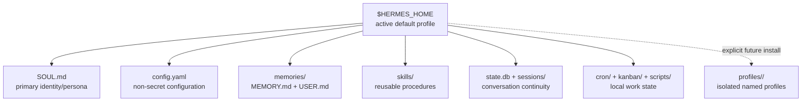
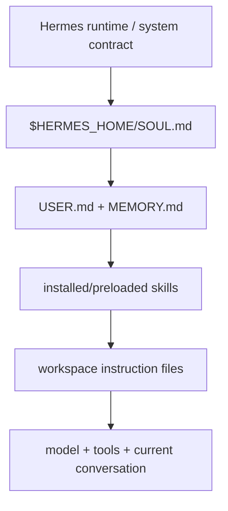
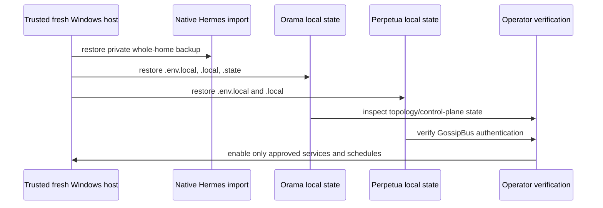

# Windows Hermes Harness — New-Machine Setup and Pre-v2 Private Recovery

> **Scope:** Set up the primary/default Hermes agent on a new Windows machine, install ECC
> into the *active* Hermes home, and restore the local-only Orama/Perpetua mesh state needed
> for a controlled v2 upgrade.
>
> **Security boundary:** This guide names paths, variables, and verification commands only.
> Never put secret values, private backups, OAuth state, `.env.local`, `.local/`, `.state/`,
> or decrypted archives in Git, agent inboxes, GossipBus, email, chat, or an untrusted machine.
>
> **Related:** [P5/P6 LAN discovery and swarm gates](../plans/2026-07-26-p5-p6-lan-discovery-swarm-approval-plan.md)
> · [mesh migration ladder](../v2/50-mesh-security-migration-ladder.md)
> · [Hermes portable-brain map](../../bin/orama-system/skills/hermes-harness/references/hermes-portable-brain-map.md).

---

## 1. Mental model: default is the Hermes home root

The primary greeting agent is the **`default` profile**. It is not normally stored at
`profiles/default/`; it is the active `$HERMES_HOME` directory itself.

On the source Windows host, that root resolves to `%LOCALAPPDATA%\hermes`. Do not assume
that literal path on a new machine: resolve it first.

```powershell
$HermesConfig = hermes config path
$HermesHome = Split-Path -Parent $HermesConfig
"HERMES_HOME=$HermesHome"
hermes profile list
```

A fresh installation may have no `$HermesHome\profiles\` directory. Named profiles appear
only after explicit creation/materialization under:

```text
$HERMES_HOME\profiles\<slug>\
```



### Default-root inventory

```text
$HERMES_HOME/
├── SOUL.md                 # identity and operating character
├── config.yaml             # non-secret settings
├── .env                    # secrets; private
├── auth.json               # OAuth/credential pools; private
├── auth/                   # provider authentication material; private
├── memories/               # USER.md and MEMORY.md
├── skills/                 # reusable SKILL.md procedures
├── state.db                # canonical SQLite session store
├── sessions/               # session/routing artifacts
├── cron/                   # scheduler definitions/output
├── kanban/ and kanban.db   # local multi-agent board state
├── scripts/                # local helpers
├── state/                  # runtime state
└── state-snapshots/        # update/recovery snapshots
```

`logs/`, caches, dependency directories, and the installed Hermes source tree are runtime
concerns. `backups/` and `migration/` appear only after the related operation runs.

---

## 2. Install Hermes and verify the live root

1. Install Hermes from the official distribution, configure a provider, and run the current
   doctor command.
2. Resolve the active root rather than guessing it.
3. Confirm that `default` is active before importing private state.

```powershell
hermes doctor
hermes config check
hermes config path
hermes profile list
```

Hermes core supplies the runtime/tool contract. The user-facing agent is layered from core
behavior plus `SOUL.md`, private memory, installed skills, project context (`AGENTS.md`,
`.hermes.md`, `CLAUDE.md`, `.cursorrules`), the selected model, and the current conversation.



---

## 3. Restore the private primary-agent backup

The source machine's encrypted pre-v2 bundle contains a **native Hermes whole-home backup**
beneath `hermes/native/`. Decrypt it only on a trusted target using an AES-capable archive tool.

```powershell
# Example after decrypting into a temporary trusted directory.
hermes import .\hermes\native\hermes-default-native-pre-v2-backup.zip
```

After import, inspect configuration, provider authentication, channel pairings, cron jobs,
and session state before starting any gateway or automation. Do not treat an import as
authorization to enable outbound messaging or scheduled jobs.

Use native Hermes backup/import as the baseline full-home recovery mechanism:

```powershell
hermes backup -o "$env:USERPROFILE\Backups\hermes-default-private-backup.zip"
# On a trusted fresh target:
hermes import "$env:USERPROFILE\Backups\hermes-default-private-backup.zip"
```

---

## 4. Install ECC into the **active** Hermes home

ECC must target the resolved `$HERMES_HOME`, not an obsolete conventional `%USERPROFILE%\.hermes`
directory when Hermes uses a different active home.

### Preflight

```powershell
$HermesHome = Split-Path -Parent (hermes config path)
$env:HERMES_HOME = $HermesHome
$EccRoot = Join-Path $env:PERPETUA_TOOLS_PATH 'vendor\ecc-tools'

# Run from a trusted ECC checkout. Confirm the reported install root equals $env:HERMES_HOME.
node "$EccRoot\scripts\install-apply.js" --target hermes --profile minimal --dry-run --json
```

**Stop if the dry-run names `%USERPROFILE%\.hermes` instead of `$env:HERMES_HOME`.** That indicates
adapter drift. The ECC Hermes target must honor `HERMES_HOME` and fall back to `~/.hermes` only
when the variable is unset.

### Apply and validate

```powershell
node "$EccRoot\scripts\install-apply.js" --target hermes --profile minimal
node "$EccRoot\scripts\doctor.js" --target hermes --json
hermes skills list
```

Expected managed artifacts include:

```text
$HERMES_HOME\ecc-install-state.json
$HERMES_HOME\rules\
$HERMES_HOME\skills\configure-ecc\
$HERMES_HOME\skills\ecc-guide\
$HERMES_HOME\skills\ecc-recipes\
$HERMES_HOME\commands\
```

ECC must not modify Hermes `config.yaml`, `.env`, `auth.json`, or private memory. A healthy
doctor report has one Hermes target checked with zero warnings and zero errors.

---

## 5. Restore Orama and Perpetua local-only mesh state

Install trusted clones first. Then copy the decrypted archive's local-only state to the matching
roots; never copy these into a Git worktree before the clone's ignore rules are present.

```text
<decrypted-bundle>/
├── orama-system/
│   ├── .env.local
│   ├── .local/
│   └── .state/
└── perpetua-tools/
    ├── .env.local
    └── .local/
```



### Required mesh/gossip secret classes

| Item | Role | Preservation rule |
|---|---|---|
| `GOSSIP_SHARED_SECRET` | Shared LAN gossip authentication | Same value on every intended peer; transfer only OOB/encrypted. |
| `ORAMA_CONTROL_PLANE_TOKEN` | Orama peer/control-plane bearer authentication | Preserve all candidates first; reconcile against the running service before a restart or rotation. |
| `ORAMA_SWARM_APPROVAL_SECRET` | Instance-unique HMAC key for strict swarm preview/launch | Generate and escrow before enabling strict v2 swarm mode; do not use the gossip secret as a substitute. |
| `.local/known-peers.json` | Discovery trust/peer acknowledgements | Preserve as local state; review stale peers before enabling strict mode. |
| `.local/lan-topology-archive.json` | Endpoint continuity after tracked LAN topology removal | Create/validate on every node before IP-hygiene/v2 cutover. |
| `LM_STUDIO_*_ENDPOINTS` | Local endpoint configuration | Preserve in local-only environment state; never commit RFC1918 topology. |

### Source-host condition that requires reconciliation

On the source Windows host, `ORAMA_CONTROL_PLANE_TOKEN` has two local candidates:

```text
orama-system/.env.local
orama-system/.state/control_plane_token
```

They did not match at backup time. The restore bundle intentionally preserves both. Before
starting LAN services, determine which token the active service actually reads. Do not choose,
overwrite, or rotate a token silently.

---

## 6. v2 security and operational gates

Before strict v2 mode:

1. Confirm `GOSSIP_SHARED_SECRET` parity on every intended peer.
2. Run the local topology archive check and verify known-peer state.
3. Confirm no secret is printed in logs, GossipBus, inbox drops, Git, or shell history.
4. Keep the old/legacy swarm path available only as documented during the pre-v2 grandfathered phase.
5. Enable strict swarm/discovery flags only in a coordinated maintenance window.

Relevant flags are configuration, not backup payloads by themselves:

```text
ORAMA_SWARM_STRICT=1
ORAMA_SWARM_LEGACY_APPROVE=0
# ORAMA_APPROVE_DISCOVERY must be removed for strict v2 behavior.
```

Do not hardwire periodic monitoring into `start.ps1`. Keep coordination checks in the local
harness (`coord_comms_board.ps1`) and explicitly approve any scheduler/cron activation.

---

## 7. Completion checklist

- [ ] `$HERMES_HOME` resolved from `hermes config path`; `default` verified.
- [ ] Native Hermes import completed and reviewed before gateway start.
- [ ] ECC dry-run names the active Hermes home; ECC doctor is clean.
- [ ] Orama/PT local-only files restored outside Git tracking.
- [ ] Gossip secret parity and control-plane-token source are verified.
- [ ] Topology archive and known-peer state exist on every peer.
- [ ] No secret/archive was sent through GossipBus, agent inbox, email, or Git.
- [ ] Strict v2 flags are enabled only after fleet-wide validation.

---

## Archive handling rule

The encrypted pre-v2 archive is a **private operator artifact**, not an agent-comms attachment.
Broadcast only this guide and an availability notice; distribute the archive through a dedicated
encrypted out-of-band transfer under operator control.
